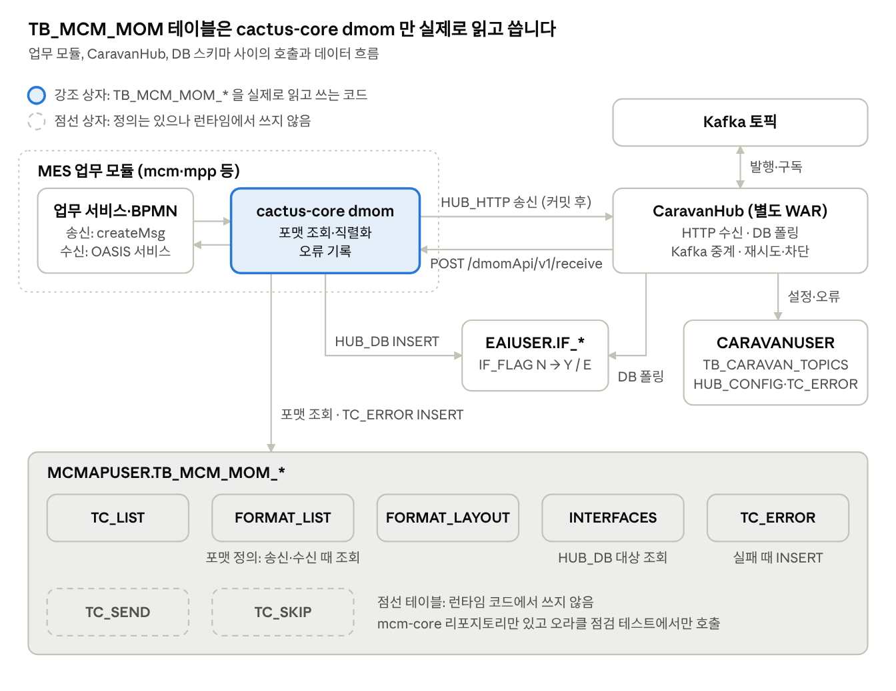
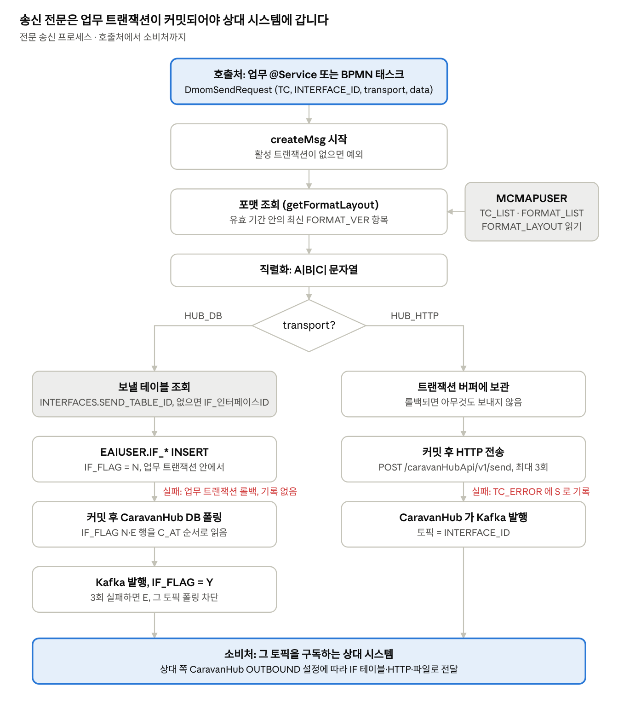
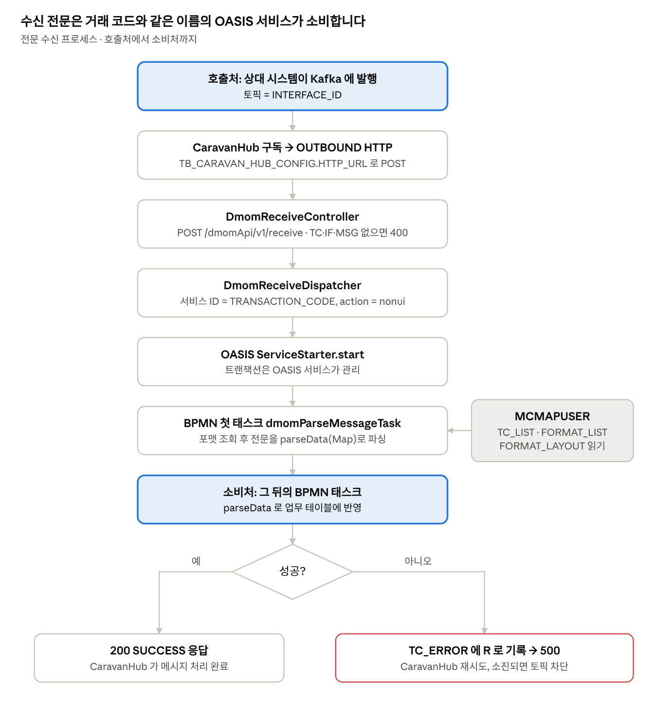
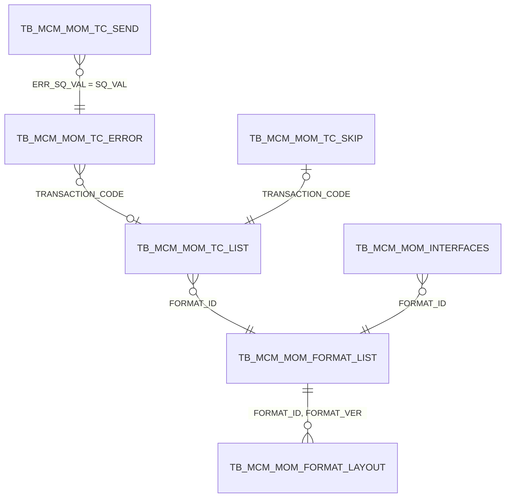

# TB_MCM_MOM 테이블 사용 프로세스 분석

2026-10-16 · dev 브랜치 기준 · 원본 Doc: https://claude.ai/code/artifact/8d29a3ae-b4cd-4bf4-ba36-9101d4e563d0

실제로 실행되는 코드 중 TB_MCM_MOM_* 테이블을 쓰는 곳은 cactus-core 의 dmom 패키지 하나입니다. 이 패키지는 전문 송신·수신 때 포맷 테이블을 읽고, 실패하면 TB_MCM_MOM_TC_ERROR 에 기록합니다. mcm-core 의 관리 화면용 리포지토리는 호출하는 코드가 없고, caravan-hub·caravan-core 는 TB_CARAVAN_* 테이블을 씁니다.

## 1. 프로세스 요약: 어디서 호출하고 어디서 소비하나

MOM 테이블을 쓰는 프로세스는 전문 송신(2가지 방식), 전문 수신, 오류 기록 네 가지입니다. **2026-10-16 dev 기준으로 이 프로세스를 부르는 업무 코드는 아직 없습니다.** `createMsg`, `dmomMessageTask`, `dmomParseMessageTask` 를 쓰는 곳은 cactus-core 자체 테스트뿐이고, 저장소의 어떤 BPMN 도 dmom 태스크를 쓰지 않습니다. 따라서 아래 표의 호출처는 "호출하도록 설계된 자리"이고, 소비처는 코드로 확인한 실제 경로입니다.

| 프로세스 | 호출처 (시작점) | 거치는 곳 | 소비처 (끝점) | MOM 테이블 |
| --- | --- | --- | --- | --- |
| 전문 송신 HUB_HTTP | MES 모듈의 업무 `@Service` 가 `DmomMessageService.createMsg()` 호출, 또는 BPMN `dmomMessageTask.createMessage` | dmom 버퍼 → 커밋 후 `POST {hub}/caravanHubApi/v1/send` → CaravanHub | Kafka 토픽(토픽명 = INTERFACE_ID) → 구독하는 상대 시스템 | TC_LIST·FORMAT_LIST·FORMAT_LAYOUT 조회, 실패 때 TC_ERROR(S) |
| 전문 송신 HUB_DB | 위와 같음 (transport = DB) | 업무 트랜잭션 안에서 `EAIUSER.IF_<인터페이스>` INSERT(IF_FLAG=N) → CaravanHub DB 폴링 | Kafka 토픽 → 상대 시스템. IF_FLAG 는 Y(성공) 또는 E(실패) | 포맷 3개 + INTERFACES.SEND_TABLE_ID 조회 |
| 전문 수신 | 상대 시스템이 Kafka 에 발행 → CaravanHub 가 구독 후 아웃바운드 HTTP 로 `POST /dmomApi/v1/receive` | `DmomReceiveController` → `DmomReceiveDispatcher` | OASIS 서비스(서비스 ID = TRANSACTION_CODE)의 BPMN. 첫 태스크 `dmomParseMessageTask` 가 전문을 Map 으로 풀고, 뒤 태스크가 업무 테이블에 반영 | 포맷 3개 조회, 실패 때 TC_ERROR(R) |
| 오류 기록 | 위 세 프로세스의 실패 지점 (`DmomDispatchSynchronization`, `DmomReceiveDispatcher`) | `DmomErrorLogger` (별도 트랜잭션) | TB_MCM_MOM_TC_ERROR 에 쌓임. 읽는 화면(tcErrorList)은 아직 없음 | TC_ERROR 등록 |

### 연동 설정에 등록된 PoC 토픽

mcm 기동 시드(`src/backend/mcm/api/src/main/java/com/dongkuk/dmes/mcm/init/seed/CaravanMetaSeeder.java`)가 `TB_CARAVAN_HUB_CONFIG` 에 아래 3건을 넣습니다. 이것이 현재 저장소에서 확인되는 유일한 구체적 송수신 경로입니다. 다만 시드는 경로만 등록하고, 이 토픽으로 실제 전문을 만드는 업무 코드는 없습니다.

| 토픽 (INTERFACE_ID) | 방향·방식 | 보내는 쪽 | 받는 쪽 |
| --- | --- | --- | --- |
| MMPPMERPTT01 | INBOUND · DB | mpp 가 `IF_MMPPMERPTT01` 에 INSERT (dmom HUB_DB 방식과 같은 경로) | CaravanHub 가 60초마다 폴링해 Kafka 발행 |
| MMCMMERPTT02 | INBOUND · HTTP | mcm 이 `CaravanHubIntegrationClient.send()` (dmom HUB_HTTP 방식이 쓰는 클라이언트) | CaravanHub 가 바로 Kafka 발행 |
| MMQCMMPNTT01 | OUTBOUND · DB | Kafka 에 들어온 전문 | CaravanHub 가 `IF_MMQCMMPNTT01` 에 INSERT → mpn 이 폴링 |

수신 쪽 `/dmomApi/v1/receive` 로 보내는 OUTBOUND HTTP 설정은 시드에 없습니다. 그래서 dmom 수신 경로는 설정도 아직 연결되지 않았습니다.

## 2. 한눈에 보기

업무 모듈은 cactus-core dmom 을 통해서만 MOM 테이블에 접근합니다. CaravanHub 는 MOM 테이블을 읽지 않고, 자기 스키마(CARAVANUSER)와 EAIUSER.IF_* 만 씁니다.

| 구성 요소 | 역할 | MOM 테이블 사용 |
| --- | --- | --- |
| cactus-core `dmom` | 각 MES 모듈 안에서 도는 전문 송수신 라이브러리 | 포맷 3개·INTERFACES 조회, TC_ERROR INSERT |
| CaravanHub (caravan-hub WAR + caravan-core 라이브러리) | 외부 시스템과 Kafka 사이 게이트웨이. HTTP·DB·파일 인바운드/아웃바운드 | 없음 (`TB_CARAVAN_*` 사용) |
| mcm-core 엔티티·리포지토리 | MCM 관리 화면 7개를 위해 준비한 JPA 코드 | 정의만 있고 호출하는 메인 코드 없음 |

`cactus.dmom.enabled` 는 기본값이 true 라서, cactus-core 를 쓰는 모든 모듈에서 dmom 이 자동으로 켜집니다. 수신 컨트롤러는 OASIS `ServiceStarter` 가 있는 모듈에서만 생깁니다.

## 3. 전문 송신 프로세스

두 방식 모두 업무 트랜잭션이 커밋된 뒤에야 전문이 Kafka 로 나갑니다. 차이는 실패를 어디서 알아채는가입니다.

| 단계 | 실행 주체 | 코드 위치 | 읽고 쓰는 테이블 |
| --- | --- | --- | --- |
| 1. 호출 | MES 모듈 업무 서비스 또는 BPMN `camunda:class="dmomMessageTask"`, `method=createMessage` | `DmomMessageService.createMsg`, `task/DmomMessageTask.java` | - |
| 2. 트랜잭션 확인 | cactus-core | `DefaultDmomMessageService.java:47-51` | - |
| 3. 포맷 조회 | cactus-core | `DmomFormatRepository.getActiveLayout` | TC_LIST, FORMAT_LIST, FORMAT_LAYOUT (R) |
| 4. 직렬화 | cactus-core | `MessageSerializer` | - |
| 5a. DB: 테이블 결정·INSERT | cactus-core (업무 트랜잭션 참여) | `DmomDbOutboundWriter.insert` | INTERFACES (R), EAIUSER.IF_* (C) |
| 6a. DB: 폴링·발행 | CaravanHub | `DbInboundHandler.pollAndSend` | EAIUSER.IF_* (R, U: IF_FLAG Y/E) |
| 5b. HTTP: 버퍼 | cactus-core | `DmomSendBuffer`, `DmomDispatchSynchronization` | - |
| 6b. HTTP: 커밋 후 전송 | cactus-core → CaravanHub | `DmomHttpSender.send` → `HttpInboundRoute` | 실패 때 TC_ERROR (C) |
| 7. 소비 | 토픽을 구독하는 상대 시스템 | 상대 CaravanHub `OutboundDispatchRoute` (DB·HTTP·FILE) | 상대 쪽 IF 테이블 등 |

재시도는 HTTP 전송에서 네트워크 예외(`RestClientException`)가 났을 때만 최대 3회, 1초 간격으로 합니다. CaravanHub 가 실패 응답을 돌려주면 다시 시도하지 않고 바로 TC_ERROR 에 기록합니다. 업무 트랜잭션은 이미 커밋되었으므로 되돌리지 않습니다.

HUB_DB 방식에서 CaravanHub 는 IF_FLAG 가 N·NULL·E 인 행을 C_AT 순서로 읽습니다. 가장 오래된 행이 E 이면 그 토픽의 폴링을 멈춥니다(순서 보장을 위한 차단). 발행에 성공하면 IF_FLAG=Y 와 IF_DATE·IF_TIME 을 채우고, 3회 실패하면 E 로 바꿉니다.

## 4. 전문 수신 프로세스

수신 전문을 실제로 소비하는 곳은 TRANSACTION_CODE 와 같은 이름으로 등록된 OASIS 서비스입니다. 별도 매핑 테이블은 없습니다. 그런 서비스는 아직 저장소에 없습니다.

| 단계 | 실행 주체 | 코드 위치 | 읽고 쓰는 테이블 |
| --- | --- | --- | --- |
| 1. 발행 | 상대 시스템 | (상대 쪽 코드) | - |
| 2. 구독·전달 | CaravanHub | `KafkaMessageConsumer` → `BusinessStart` → `OutboundDispatchRoute` → `HttpOutboundHandler` | TB_CARAVAN_HUB_CONFIG (R) |
| 3. 요청 검사 | MES 모듈 (cactus-core) | `DmomReceiveController` (`X-Client-Key` 인증) | - |
| 4. 서비스 시작 | cactus-core | `DmomReceiveDispatcher.dispatch` → `ServiceStarter.start` | - |
| 5. 파싱 | BPMN 첫 태스크 | `DmomParseMessageTask.parse` → `MessageParser` | TC_LIST, FORMAT_LIST, FORMAT_LAYOUT (R) |
| 6. 소비 | BPMN 뒷 태스크 (각 업무 모듈이 작성) | 없음 (아직 작성된 서비스 없음) | 업무 테이블 |
| 7. 실패 처리 | cactus-core | `DmomErrorLogger.logReceive` | TC_ERROR (C, ERROR_TYPE R) |

서비스에 넘겨주는 값은 `action=nonui`, `transactionCode`, `interfaceId`, `interfaceMsg`, 그리고 있을 때만 `kafkaKeyData`, `interfaceProtocol` 입니다. 감사 사용자는 `SYSTEM`, 프로그램 ID 는 `DMOM_RECV` 입니다. 실패하면 500 을 돌려주므로 CaravanHub 가 최대 3회(2초 간격) 다시 보내고, 그래도 실패하면 그 토픽의 소비를 멈춥니다. 같은 메시지를 여러 번 받을 수 있지만, 중복 수신을 막는 기능은 아직 없습니다.

## 5. 테이블 7개 정의와 관계

MCMAPUSER 스키마에 MOM 테이블 7개가 있습니다. DDL 은 mcm-core 의 Flyway `V1__baseline.sql` 에 있고, 주석은 V12, 컬럼 순서 정리는 V16 에 있습니다. 2026-10-16 DB 스냅샷 기준으로 7개 모두 0행입니다. PK 외에 인덱스와 FK 는 없습니다.

| 테이블 | 한글명 | PK | 주요 컬럼 | 런타임 사용 |
| --- | --- | --- | --- | --- |
| TB_MCM_MOM_TC_LIST | MOM 전문 목록 | TRANSACTION_CODE | TRANSACTION_NM, TRANSACTION_DESC, FORMAT_ID(NOT NULL), USE_TP, START/END_ACTIVE_DATE | 송신·수신 때 읽음 |
| TB_MCM_MOM_FORMAT_LIST | MOM 포맷 목록 | FORMAT_ID, FORMAT_VER(number 8,2) | FORMAT_NM, FORMAT_DESC, USE_TP, START/END_ACTIVE_DATE | 송신·수신 때 읽음 |
| TB_MCM_MOM_FORMAT_LAYOUT | MOM 포맷 레이아웃 | FORMAT_ID, FORMAT_VER, ITEM_SEQ | ITEM_TP, ITEM_ID, ITEM_NM, DATA_TP, DATA_LEN, DATA_DECIMAL_PREC | 송신·수신 때 읽음 |
| TB_MCM_MOM_INTERFACES | MOM 인터페이스 | INTERFACE_ID, TRANSACTION_CODE | INTERFACE_DESC, INTERFACE_PROTOCOL, FORMAT_ID, SEND_/RECV_ WORKS_CD·MODULE_ID·IF_TP·TABLE_ID, USE_TP | HUB_DB 송신 때 SEND_TABLE_ID 읽음 |
| TB_MCM_MOM_TC_ERROR | MOM 전문 오류 | SQ_VAL (SEQ_MCM_MOM_TC_ERROR) | TRANSACTION_CODE, INTERFACE_ID, INTERFACE_PROTOCOL, INTERFACE_MSG(NCLOB), KEY_DATA1~3, ERROR_TYPE, ERROR_CODE, ERROR_MSG(1000), ERROR_STATUS_CODE | 송신·수신 실패 때 INSERT |
| TB_MCM_MOM_TC_SEND | MOM 전문 송신(재전송 이력) | SEND_SQ_VAL (SEQ_MCM_MOM_TC_SEND) | ERR_SQ_VAL(NOT NULL), TRANSACTION_CODE, INTERFACE_ID, INTERFACE_MSG(NCLOB), SEND_RESULT | 사용하지 않음 |
| TB_MCM_MOM_TC_SKIP | MOM 전문 건너뛰기 | TRANSACTION_CODE | SKIP_LEVEL, USE_TP, START/END_ACTIVE_DATE | 사용하지 않음 |

모든 테이블에는 VER 와 감사 컬럼 8개(C_/U_ USR_ID·AT·SVC_ID·PGM_ID)가 있습니다. 아래 관계는 SQL 조인과 ERD 힌트(`src/backend/mdm/api/src/main/resources/erd/hints/mcm.json`)에서 추정한 것입니다.

문서에 나오는 caravan 쪽 `TB_MCM_MOM_KAFKA_TOPICS`, `TB_MCM_MOM_KAFKA_SERAI_CONFIG` 는 문서와 주석에만 남은 옛 이름입니다. mcm-core DDL 에는 없고, 실제 코드는 CARAVANUSER 스키마의 `TB_CARAVAN_TOPICS`, `TB_CARAVAN_HUB_CONFIG` 를 씁니다.

## 6. 테이블별 CRUD 매트릭스

위 세 줄은 실제로 실행되는 프로세스이고, 아래 세 줄은 설계만 있는 화면입니다. C = 등록, R = 조회, U = 수정, D = 삭제입니다.

| 프로세스 | TC_LIST | FORMAT_LIST | FORMAT_LAYOUT | INTERFACES | TC_ERROR | TC_SEND | TC_SKIP | 그 밖의 테이블 |
| --- | --- | --- | --- | --- | --- | --- | --- | --- |
| 전문 송신 HUB_DB (실행) | R | R | R | R | - | - | - | EAIUSER.IF_* C |
| 전문 송신 HUB_HTTP (실행) | R | R | R | - | C (실패 때) | - | - | - |
| 전문 수신 (실행) | R | R | R | - | C (실패 때) | - | - | 업무 테이블 (OASIS 서비스가 정함) |
| 인터페이스·포맷 관리 화면 (설계) | C/U/D | R/C/U/D | R/C/D | R/C/U/D | - | - | - | - |
| 비정상 TC 등록 화면 (설계) | R | - | - | - | - | - | R/C/U | - |
| 오류 조회·재전송 화면 (설계) | R | - | R | - | R | R/C | - | - |

현재 런타임이 쓰는 테이블은 포맷 3개와 INTERFACES·TC_ERROR 다섯 개입니다. 포맷 데이터를 넣을 화면이 없으므로, 지금은 SQL 로 직접 입력해야 송신과 수신이 동작합니다.

## 7. 포맷 정의와 전문 직렬화·파싱 규칙

전문은 고정 길이가 아니라 `|` 로 구분하며, 마지막 값 뒤에도 `|` 를 붙입니다. 고정 폭은 숫자·날짜 항목에만 적용합니다. 포맷 조회는 송신과 수신이 같은 SQL(`DmomMapper.getFormatLayout`)을 씁니다.

### 포맷 조회 순서

1. `TC_LIST` 에서 TRANSACTION_CODE 로 FORMAT_ID 를 찾습니다. 송신 요청에 `transferTc` 가 있으면 그 값으로 조회합니다.
2. `FORMAT_LIST` 에서 그 FORMAT_ID 의 버전 중 유효 기간 안에 있는 것을 고릅니다. TC_LIST 와 FORMAT_LIST 모두 `START_ACTIVE_DATE < 현재 < END_ACTIVE_DATE` 를 만족해야 하고, NULL 은 제한 없음으로 봅니다. 경계값은 포함하지 않습니다.
3. 그중 FORMAT_VER 가 가장 큰 버전 하나를 고릅니다(`FETCH FIRST 1 ROWS ONLY`).
4. 그 버전의 `FORMAT_LAYOUT` 항목을 ITEM_SEQ 순서로 읽습니다.
5. 항목이 하나도 없으면 `DmomException("FORMAT_LAYOUT 없음")` 을 던집니다.

`interfaceId` 는 조회 메서드에 전달되지만 SQL 에서는 쓰지 않습니다. 즉 포맷은 거래 코드만으로 정해집니다. 포맷 캐시는 없어서, 송신과 수신마다 이 SQL 을 실행합니다.

### ITEM_TP (항목 구분)

| 값 | 의미 | 직렬화 동작 |
| --- | --- | --- |
| E | 단일 항목 | `data.get(ITEM_ID)` 값을 한 칸 씁니다 |
| G | 반복 그룹 머리 | 자기 칸은 쓰지 않습니다. DATA_LEN 이 반복 횟수입니다 |
| GE | 그룹 안 항목 | `data.get(그룹ID)` 의 `List<Map>` 에서 행마다 씁니다. 행이 모자라면 빈 칸으로 채우고, 넘치면 오류입니다 |

### DATA_TP (데이터 구분)

| 값 | 형식 | 송신(직렬화) | 수신(파싱) |
| --- | --- | --- | --- |
| 1 | 문자열 | 그대로 씁니다 | 앞뒤 공백을 지웁니다 |
| 2 | 숫자 | 정수부를 `DATA_LEN − DATA_DECIMAL_PREC` 자리로 0 채움, 소수부를 PREC 자리로 붙입니다. 소수점은 쓰지 않습니다 | BigDecimal 로 바꾸고 10^PREC 로 나눕니다 |
| 3 | 날짜 | `- / : .` 와 공백을 빼고, 뒤를 0 으로 채운 뒤 DATA_LEN 으로 자릅니다 | "1900" 보다 크고 "9999" 보다 작을 때만 값으로 봅니다 |
| 4 | 문자열2 | 앞뒤 공백을 지웁니다 | 앞뒤 공백을 지웁니다 |
| 5 | 그대로 | 그대로 씁니다 | 그대로 받습니다 |

### 예시 (가상 레이아웃)

아래는 규칙을 설명하기 위한 가상 예시입니다. 실제 DB 에는 포맷 데이터가 아직 없습니다.

| ITEM_SEQ | ITEM_TP | ITEM_ID | DATA_TP | DATA_LEN | PREC | 입력값 | 전문 칸 |
| --- | --- | --- | --- | --- | --- | --- | --- |
| 1 | E | lotNo | 1 | 20 | 0 | `L001` | `L001` |
| 2 | E | qty | 2 | 8 | 2 | `12.5` | `00001250` |
| 3 | E | workDt | 3 | 8 | 0 | `2026-10-16` | `20261016` |
| 4 | G | items | - | 2 | - | 2행 반복 | (칸 없음) |
| 5 | GE | code | 1 | 10 | 0 | `A`, `B` | `A`, `B` |

결과 전문은 `L001|00001250|20261016|A|B|` 입니다.

### 송신 때 검사

- 값에 `|` 가 있으면 오류입니다.
- 값이 `ERROR` 로 시작하면 오류입니다.
- `,[]` 를 뺀 값에 문자열 "NULL" 이 들어 있으면 빈 값으로 바꿉니다.
- `SNDR_INFORM_EDIT_PGM_ID` 는 14자로 자릅니다.

### 수신 때 검사

- `split("\\|", -1)` 로 나눠 빈 칸도 유지합니다.
- 칸이 모자라면 빈 값으로 채웁니다.
- 레이아웃보다 칸이 남고 그 칸이 비어 있지 않으면 오류입니다.
- 숫자 칸에 숫자가 아닌 값이 있으면 `DmomException` 을 던집니다.

## 8. 오류 기록: TC_ERROR 테이블 두 개

전문 처리 오류는 `TB_MCM_MOM_TC_ERROR` 에, Kafka 처리 오류는 `TB_CARAVAN_TC_ERROR` 에 따로 기록합니다. 두 테이블은 컬럼 구성이 비슷해서 혼동하기 쉽습니다.

| 항목 | TB_MCM_MOM_TC_ERROR | TB_CARAVAN_TC_ERROR |
| --- | --- | --- |
| 스키마 | MCMAPUSER | CARAVANUSER |
| 기록하는 곳 | cactus-core `DmomErrorLogger` (MyBatis `insertTcError`) | caravan-core `KafkaErrorRepository` (JPA) |
| 기록 시점 | HUB_HTTP 송신 실패, 수신 처리 실패 | Kafka produce 실패, consume 재시도 소진 |
| SQ_VAL | `SEQ_MCM_MOM_TC_ERROR.NEXTVAL` (숫자) | `yyyyMMddHHmmssSSS-xxx` (문자열) |
| ERROR_TYPE | S = 송신, R = 수신 | S = produce, R = consume |
| INTERFACE_PROTOCOL | `HUB_HTTP` 또는 수신 요청의 값 | `KAFKA` |
| ERROR_CODE | 예외 클래스 이름 (100자) | 처리 결과 코드 |
| ERROR_MSG | 예외 메시지 (1000자) | consume 오류는 `[offset=N]` 을 앞에 붙임 |
| ERROR_STATUS_CODE | 항상 `N` (미처리) | 기본 `N` |
| 감사 사용자 | 수신은 `SYSTEM` / `DMOM_RECV` | `CARAVAN:<bizSystem>` |

### TB_MCM_MOM_TC_ERROR 기록 방식

- `DmomErrorLogger.log(msg, e)` 는 송신 실패에 씁니다. `DmomDispatchSynchronization.afterCommit` 에서 부릅니다.
- `DmomErrorLogger.logReceive(...)` 는 수신 실패에 씁니다. `DmomReceiveDispatcher` 에서 부릅니다.
- 각 INSERT 는 `TransactionTemplate(PROPAGATION_REQUIRES_NEW)` 안에서 실행합니다. 트랜잭션 매니저는 `cactus.dmom.error-tx-manager` (기본 `transactionManager`)입니다.
- 기록 자체가 실패하면 예외를 삼키고 로그만 남깁니다.
- KEY_DATA1~3 은 채우지 않습니다.
- **HUB_DB 송신 실패는 기록하지 않습니다.** IF 테이블 INSERT 가 실패하면 예외가 업무 트랜잭션을 롤백시키기 때문입니다.

ERROR_STATUS_CODE 를 `N` 다음 상태로 바꾸는 코드는 아직 없습니다. 재전송 화면(tcErrorResendPop)이 구현되면 TC_SEND 에 재전송 이력을 남길 예정입니다.

## 9. MCM 관리 화면 7개: 설계만 있고 구현되지 않음

mcm-core 에는 MOM 테이블용 엔티티와 리포지토리가 있지만, 이를 부르는 메인 코드가 없습니다. 프론트엔드 화면, 컨트롤러, OASIS 서비스, BPMN, 메뉴 등록이 모두 없습니다. 리포지토리는 오라클 점검 테스트(`MomTcErrorSearchOraTest`)에서만 씁니다.

아래 표는 리포지토리 Javadoc, e2e 스모크 테스트, `docs/guide/reference/mcm-reference.md` 에서 읽은 설계 의도입니다. 메뉴 경로는 e2e 스모크 테스트에 적힌 값입니다.

| 화면 ID | 메뉴 경로 | 기능 | 테이블 작업 | 준비된 리포지토리 |
| --- | --- | --- | --- | --- |
| interfaceList | (미확인) | 인터페이스 정의를 조회·저장하고, 삭제 때 TC_LIST·FORMAT_LIST 까지 함께 지웁니다. 송신 쪽만 보여 주고 FORMAT_VER 는 1 로 고정합니다 | INTERFACES CRUD, TC_LIST·FORMAT_LIST C/U/D | MomInterfaceRepository, MomTcListRepository, MomFormatListRepository |
| messageSender | 공통관리 > Interface 관리 > 메시지 전송 | 인터페이스와 TC 를 팝업에서 골라 메시지를 보냅니다 | INTERFACES R, FORMAT_LAYOUT R | MomInterfaceRepository, MomFormatLayoutRepository |
| interfaceFormatList | 공통관리 > Format 관리 > I/F Format 조회 | 포맷 목록과 버전 이력을 보여 주고 비교합니다 | FORMAT_LIST R, INTERFACES R | InterfaceFormatListRepository (버전 이력용 MyBatisDao 는 없음) |
| interfaceFormatLayout | 공통관리 > Format 관리 > I/F Format Layout 관리 | 포맷을 골라 레이아웃 항목을 편집합니다. 저장할 때 기존 항목을 모두 지우고 다시 넣습니다 | FORMAT_LIST R, FORMAT_LAYOUT R/D/C | InterfaceFormatLayoutRepository |
| tcAbnormalData | 공통관리 > TC Error > 비정상 TC 등록 | 전문ID·Skip LEVEL·사용구분으로 건너뛰기 규칙을 조회·저장합니다 | TC_LIST R, TC_SKIP R·upsert | MomTcSkipRepository |
| tcErrorList | (미확인) | 오류를 조회합니다. 기본 기간은 7일 전부터 지금까지이고, 행을 누르면 재전송 팝업을 엽니다 | TC_ERROR R, TC_LIST R, TC_SEND count | MomTcErrorRepository, TcErrorRowView |
| tcErrorResendPop | (팝업) | 송신(S) 오류만 다시 보냅니다. 수신(R) 오류는 제외합니다 | TC_SEND C(예정), FORMAT_LAYOUT R | MomTcSendRepository (count 만 있음) |

### tcErrorList 조회 SQL 요약

`MomTcErrorRepository.search` 는 이 화면들 가운데 유일하게 실제 Oracle 에서 검증된 조회입니다.

- TC_ERROR 를 기준으로 TC_LIST 를 LEFT JOIN 해서 TRANSACTION_NM 을 가져옵니다. TC_LIST 에 없는 TC 도 이름 없이 보입니다.
- `COUNT(TC_SEND WHERE ERR_SQ_VAL = SQ_VAL)` 로 재전송 횟수(resendCnt)를 구합니다.
- 조건은 C_AT 기간, INTERFACE_ID·ERROR_CODE·TRANSACTION_CODE 부분 일치(대소문자 구분)입니다. 정렬은 C_AT 내림차순입니다.
- INTERFACE_MSG(NCLOB)는 전체를 읽어서 재전송 팝업이 그대로 다시 보낼 수 있게 합니다.

`docs/refactor-be-2026-10/findings.md` 의 D2 항목은 이 리포지토리들을 "메인 코드 사용처 없음"으로 기록하고, X1 설계가 끝날 때까지 옮기지 않기로 했습니다.

## 10. 확인된 문제와 열린 질문

구조 문제 1건, 잠재 결함 3건, 문서와 코드 불일치 6건, 열린 질문 6건을 확인했습니다.

### 구조 문제

- **모듈 경계 위반 (findings.md X1).** 공통 라이브러리인 cactus-core 가 mcm 이 소유한 `MCMAPUSER.TB_MCM_MOM_*` 에 SQL 을 직접 실행합니다. cactus-core 에 포트(`DmomFormatSource`, `DmomErrorSink`)를 두고 구현은 mcm-core 에 두거나, 별도 dmom starter 로 분리하자는 제안이 있습니다.

### 잠재 결함 (코드 확인, 실행으로 검증하지는 않음)

- **오류 기록 트랜잭션 분리.** TC_ERROR INSERT 는 업무용 SqlSessionTemplate 으로 실행하고, `REQUIRES_NEW` 는 `transactionManager` 로 엽니다. 둘이 같은 DataSource 에 묶여 있지 않으면, 오류 기록이 업무 롤백과 함께 사라질 수 있습니다. DataSource 연결은 확인하지 못했습니다.
- **숫자 직렬화 예외.** 숫자가 아닌 값은 `DmomException` 대신 `NumberFormatException` 을 그대로 던집니다. `"12."` 같은 값은 `ArrayIndexOutOfBoundsException` 을 일으킬 수 있습니다.
- **caravan-hub 설정 조인.** `TB_CARAVAN_TOPICS` 의 PK 는 (TOPIC_ID, BIZ_SYSTEM) 인데, 인바운드 설정 조회는 TOPIC_ID 로만 조인합니다. 같은 토픽이 여러 biz-system 에 등록되면 설정 행이 중복됩니다.

### 문서와 코드 불일치 (코드가 정답)

| 항목 | 문서 | 코드 |
| --- | --- | --- |
| DB 문법 | MSSQL `TOP 1` (전문송수신 설계 02·03·05) | Oracle `FETCH FIRST`, `.NEXTVAL`. 매퍼 머리 주석도 아직 "MSSQL" |
| 프로토콜·클라이언트 이름 | `SERAI_HTTP`, `SeraiIntegrationClient`, `cactus.serai.retry` | `HUB_HTTP`, `CaravanHubIntegrationClient`, `cactus.caravan-hub.retry` |
| HUB_DB 실패 시점 | beforeCommit 에서 실패 | `createMsg` 안에서 즉시 INSERT |
| caravan 테이블 | `TB_MCM_MOM_KAFKA_TOPICS`, `TB_MCM_MOM_KAFKA_SERAI_CONFIG` | `TB_CARAVAN_TOPICS`, `TB_CARAVAN_HUB_CONFIG` |
| 없는 클래스 | `DmomFormatMapper`, `SeraiMessageDispatcher`, `InterfaceFormatListMyBatisDao` | 없음 |
| 콘솔 TC Error 화면 | `docs/kafka/Caravan-Hub_연동_개발자매뉴얼.md` 는 콘솔 "TC Error 조회" 화면이 `TB_MCM_MOM_TC_ERROR` 를 본다고 적음 | caravan-console 에 TC_ERROR 를 읽는 코드 없음. 현재 이 테이블을 읽는 소비처는 어디에도 없음 |

PoC 토픽 3개(MMPPMERPTT01, MMCMMERPTT02, MMQCMMPNTT01)는 mcm 시드, caravan-core·cactus-core 테스트와 Javadoc 예시, localKafka 토픽 목록에만 나옵니다. mpp·mpn·mqc 에는 이 IF 테이블에 쓰거나 폴링하는 코드가 없습니다.

### 열린 질문 (mcm-reference.md)

- [ ] Q-501: 레이아웃 삭제가 FORMAT_VER 없이 FORMAT_ID 로만 지웁니다. 다른 버전까지 지워지는데 의도인가요?
- [ ] Q-400: `MCM_BACKUP.TB_MCM_MOM_FORMAT_LAYOUT` 와 UNION 하는 이력 조회를 어떻게 할까요? 백업 테이블은 없습니다.
- [ ] Q-203: SKIP_LEVEL 기본값은 무엇인가요?
- [ ] Q-204: 유효 기간 컬럼을 화면에 보여줄까요?
- [ ] Q-100/Q-103: 재전송 횟수를 어떻게 세고, ERROR_STATUS_CODE 를 어떻게 바꿀까요?
- [ ] TC_SKIP 규칙 적용과 KAFKA_KEYDATA 기반 중복 수신 방지는 언제 구현할까요? (수신 설계 04·05 에서 후속 항목)

## 11. 근거 파일

모든 경로는 저장소 루트 기준입니다. 조사는 dev 브랜치의 코드를 읽어서 했고, 실행해 보지는 않았습니다.

| 영역 | 파일 |
| --- | --- |
| 매퍼 | `src/backend/cactus-core/src/main/resources/persistence/dmom/DmomMapper.xml` |
| 송신 | `cactus-core/.../dmom/message/DefaultDmomMessageService.java`, `task/DmomMessageTask.java`, `dispatch/DmomDbOutboundWriter.java`, `dispatch/DmomDispatchSynchronization.java`, `dispatch/DmomHttpSender.java`, `context/DmomSendBuffer.java` |
| 수신 | `cactus-core/.../dmom/receiver/DmomReceiveController.java`, `DmomReceiveDispatcher.java`, `DmomParseMessageTask.java`, `MessageParser.java` |
| 포맷·직렬화 | `cactus-core/.../dmom/format/DmomFormatRepository.java`, `FormatItem.java`, `MessageSerializer.java` |
| 오류 기록 | `cactus-core/.../dmom/error/DmomErrorLogger.java` |
| 설정 | `cactus-core/.../dmom/DmomAutoConfiguration.java`, `DmomProperties.java`, `integration/caravanhub/DefaultCaravanHubIntegrationClient.java` |
| 연동 시드 | `src/backend/mcm/api/src/main/java/com/dongkuk/dmes/mcm/init/seed/CaravanMetaSeeder.java` |
| DDL | `src/backend/mcm-core/src/main/resources/db/migration/oracle/mcmapuser/V1__baseline.sql`, `V12__column_comments.sql`, `V16__column_order.sql` |
| mcm-core | `src/backend/mcm-core/.../mcm/entity/Mom*.java`, `repository/Mom*Repository.java`, `InterfaceFormat*Repository.java`, `TcErrorRowView.java`, 테스트 `oracheck/MomTcErrorSearchOraTest.java` |
| caravan | `src/backend/caravan-hub/.../mapper/CaravanHubConfigMapper.java`, `inbound/db/DbInboundHandler.java`, `outbound/OutboundDispatchRoute.java`, `src/backend/caravan-core/.../consumer/KafkaMessageConsumer.java` |
| 설계 문서 | `docs/cactus/002_전문송수신(포멧,오아시스,메시지태스크)/01~06`, `docs/kafka/Caravan-Hub_연동_개발자매뉴얼.md`, `docs/guide/reference/mcm-reference.md`, `docs/refactor-be-2026-10/findings.md` |

## 12. 화면 시안 12개

시안 원본은 [`design/`](design/) 폴더에 있습니다. 게시본은 <https://claude.ai/artifact/Tx9qLwRLzoi9LRRC5j8zqv> (Design 캔버스) 입니다.
`*.dc.html` 파일은 Design 런타임(`support.js`)으로 그리는 원본이므로, 로컬에서 브라우저로 열면 화면이 그려지지 않습니다. 화면은 게시본에서 보고, 로컬 파일은 원본 보관과 수정용으로 씁니다. 배치는 `design/canvas.json` 에 있습니다.

| 줄 | 파일 | 화면 | 항목·기능의 근거 |
| --- | --- | --- | --- |
| 인터페이스·포맷 | `Main.dc.html` | 인터페이스 정의 (interfaceList) | `MomInterfaceRepository.findByFilter` 조회 조건 5개, mcm-reference 결정(전송방식 콤보 폐지, 송신만 노출, FORMAT_VER=1) |
| | `FormatList.dc.html` | I/F Format 조회 (interfaceFormatList) | `InterfaceFormatListRepository.searchMasters`. 변경이력은 조회 SQL 이 없어 Q-400 미결로 표시 |
| | `FormatLayout.dc.html` | I/F Format Layout 관리 (interfaceFormatLayout) | FORMAT 선택 팝업(e2e), 레이아웃 컬럼 7개, replaceAll 저장. ITEM_TP·DATA_TP 값은 Phase0 문서 |
| | `MessageSender.dc.html` | 메시지 전송 (messageSender) | 전문ID·TC 입력, 찾기 팝업, 전송(mcm-reference, e2e). 헤더 7 + 본문 N 구성 |
| 전문 오류 | `TcErrorList.dc.html` | TC Error 조회 (tcErrorList) | `MomTcErrorRepository.search` 조건·결과 컬럼, 부문구분 LoV, 기본 기간 today-7, TC 셀 → 재전송 |
| | `TcErrorResend.dc.html` | 재전송 팝업 (tcErrorResendPop) | S 만 재전송, PROTOCOL 숨김, TC_SEND 재전송 이력 |
| | `TcAbnormalData.dc.html` | 비정상 TC 등록 (tcAbnormalData) | `searchTcSkip` 조건 3개·결과 컬럼 7개, 전문ID·전문명 읽기 전용(e2e) |
| 카프카 운영 | `KafkaDashboard.dc.html` | 대시보드 | `ConsoleDashboardService.summary` / `DashboardSummaryResponse` |
| | `TopicMgmt.dc.html` | 토픽 관리 | `TopicStatusResponse`, e2e "카프카관리 › 토픽 관리" 버튼, `ConsoleTopicService` 제어 기능 |
| | `MessageBrowse.dc.html` | 메시지 조회 | `MessageSearchRequest`·`MessageResponse`, 상태 5종, `fromOffset` |
| | `HubConfig.dc.html` | 연동 설정 | `TB_CARAVAN_HUB_CONFIG` 컬럼, 연동 방식별 입력 칸 |
| | `HostMgmt.dc.html` | 호스트 관리 | `TB_CARAVAN_APPHOST` 컬럼·조회 조건 |

데이터 출처:
- 실제 값: 연동 설정 3행, 호스트 1행(로컬 DB `l_main` 실측), 인터페이스 ID 4개(시드 토픽 3개 + IFUSER `IF_MMPPMMCMTT01`).
- 예시 값: 거래 코드, 포맷, 레이아웃 항목명, 오류 건, 메시지, offset, 대시보드 숫자. 전문 값은 코드 Javadoc 의 예시 전문을 썼습니다.

근거가 약해 정한 부분:
- 카프카 운영 메뉴명 중 e2e 로 확인된 것은 "토픽 관리" 하나입니다. 대시보드·메시지 조회·연동 설정·호스트 관리는 기능에 맞춰 붙였습니다.
- Skip LEVEL 은 값이 정해지지 않아(Q-203) 직접 입력 칸으로 두었습니다.
